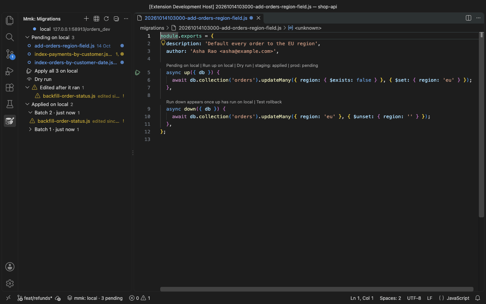
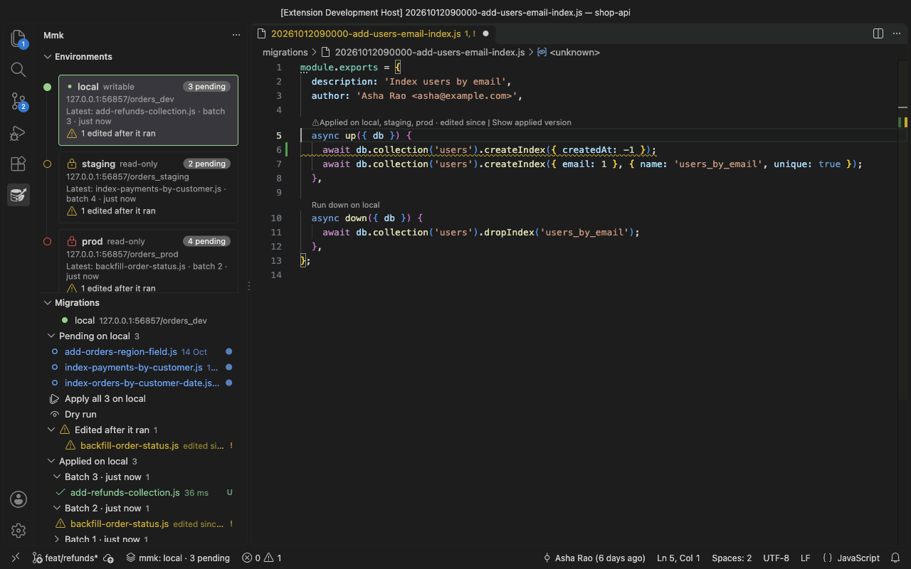
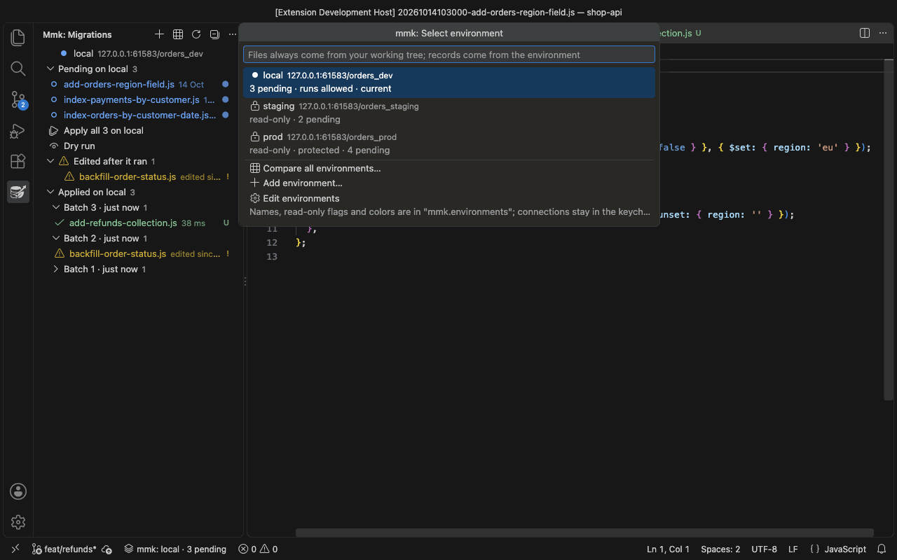

<div align="center">


# Mongo Migrate Kit for VS Code

**[mongo-migrate-kit](https://mongo-migrate-kit.vercel.app/) in your editor: create, run, roll back
and compare MongoDB migrations.**

[](https://marketplace.visualstudio.com/items?itemName=guptasantosh327.mongo-migrate-kit)
[](https://open-vsx.org/extension/guptasantosh327/mongo-migrate-kit)
[](https://www.npmjs.com/package/mongo-migrate-kit)
[](https://opensource.org/licenses/MIT)

**[mongo-migrate-kit docs](https://mongo-migrate-kit.vercel.app/guide/)** ·
**[Quick start](https://mongo-migrate-kit.vercel.app/guide/getting-started)** ·
**[Changelog](CHANGELOG.md)**

<br>



<sub>Creating a migration, running it on local, and seeing it applied.</sub>

</div>

---

Create, run and roll back mongo-migrate-kit (mmk) MongoDB migrations without leaving the editor.
Compare your branch with staging and prod, and get a warning the moment you edit a migration that
has already run.

The extension is a window onto the `mmk` command. It runs **your project's own** mongo-migrate-kit
from `node_modules`, with your `mmk.config.*`, your `.env` and your Node.js, and shows what
`mmk … --json` returns. It never decides on its own what is pending, applied or changed, and
whatever it shows, `npx mmk` says the same in a terminal.

## Your local database

- **The environments pipeline** at the top of the mmk sidebar: local → staging → prod, each with
  its pending count, the migration applied there last and anything that needs attention (or
  mmk's error, when it can't be read). Below it, *Review N pending* (the console's plan),
  *Console* and *New migration*, then the selected environment's pending migrations.
- **The mmk sidebar:** what's pending, what was edited after it ran, and what's applied, grouped by
  batch. *Apply all* and *Dry run* sit next to the pending list.
- **Create a migration** with the `+`: type a name, see the file mmk will create, pick JavaScript or
  TypeScript, and the new file opens.
- **Run links** above `up()` and `down()`: *Run up on local*, *Dry run*, *Redo*, *Run down on local*,
  with the batch and the time once it has run.
- **Badges and status bar:** `●` on pending files, `!` on edited ones, and `mmk: local · 3 pending`.
- **Plan, then apply:** in the migration console, *Plan* shows what `up` would apply, in order (mmk's
  dry run); *Apply* runs it. While mmk runs, its own output shows as it comes, and the result says
  what ran, what failed and where the database stands, with the next step: open the file, roll
  back the batch, or release a held lock.
- **Roll back a batch** (`mmk: Roll back a batch…`, or from the console): the confirmation names
  every migration in it.
- **Who holds the migration lock:** when another run holds an environment's lock, the line under
  the console's tabs says so ("Locked by ci on deploy-runner-7 · 4 min"), and so do the
  environment's card in the sidebar and the status bar. Click it for the process, since when, and
  when it frees itself if that run crashed. Runs stay greyed out until it lets go; *Plan* still
  works. *Release…* asks first, and only writable environments offer it. Needs mongo-migrate-kit
  1.6.0 or later.
- **Edited after it ran:** the console says so above the table, with *Review it* and *Dismiss*.
  Dismissed, it stays quiet until that migration runs again; the table and the editor still mark
  the file.
- **Nothing runs on its own.** Every run is a click; rolling back, redoing and releasing the lock
  ask first. *Copy CLI command* gives you the same command for a terminal.

## Edits to migrations that already ran



Changing a migration after it ran is the classic mistake: the databases keep what the old `up()`
did, and a rollback runs the new `down()`. The extension catches it **while you type**, before
you save:

- A warning on the changed lines, saying where it ran, plus a Problems entry, a `!` badge and a
  run link.
- **Show applied version** finds the commit whose file matches the checksum mmk recorded and
  opens it next to yours. **Restore applied version** puts it back.

This needs mongo-migrate-kit 1.6.0 or later, which reports the checksum each migration ran with.

## Staging and prod



- **Add an environment** (`mmk: Add environment…`, the `+` next to the console's tabs, or *Add
  environment…* in the sidebar): one form with the name, the database, the connection string in a
  masked box, read-only (on by default) and a colour. The connection is tested with `mmk status`
  before it's added ("Connected: mmk status read 8 migrations on qa, 3 of them pending"), then kept
  in your **OS keychain**. It reaches mmk as `MMK_URI` / `MMK_DB` and is never written to settings,
  logs or the command line.
- **Read-only by default.** Anything but `local` only ever runs `status`, `list` and `dry-run`. The
  run links offer *Dry run* and *Copy CLI command*, and every write command refuses in code, not
  just in the UI. Deploys stay with your pipeline.
- **Each environment has its own colour** in the sidebar, the console and the status bar: local
  green, prod red, the others yellow, blue, purple and orange in turn. Change one with
  *mmk: Change environment colour…* (or the colour button on its card in the sidebar). The status
  bar turns amber for yellow and orange, red for red.
- **The migration console** (`mmk: Open migration console`, or the table icon in the mmk view):
  every migration against every database in one editor tab. Pick an environment, filter to
  *Pending*, *Needs attention* or *Only differences* (with notes like "On staging, not prod"), and
  compare the files on `origin/main` instead of your branch (copied from git, without touching your
  checkout). The migration you pick shows its record on each environment, the actions the selected
  environment allows, the CLI command to copy, and the environment's latest batches.
  *Compare all environments* opens it on *Only differences*.
- **After a branch switch**, local migrations whose files are on another branch are named, with
  the branch.

**The database user for staging and prod:** with mongo-migrate-kit 1.6.0 or later, a user with
only the `read` role is enough, because reading never writes. mongo-migrate-kit 1.5 creates the
changelog's index whenever it connects, even to read, so there the user needs permission to write
(for example `readWrite`). Either way, the extension never runs a write command on a read-only
environment.

## Requirements

- mongo-migrate-kit installed in your project: `npm install mongo-migrate-kit mongodb`
- Node.js on `PATH` (or set `mmk.nodePath`)
- A trusted workspace: running mmk runs your project's config and migrations

It starts in any folder with an `mmk.config.js`, `.ts` or `.json`, or a `package.json` that depends
on `mongo-migrate-kit`. Monorepos and multi-root workspaces work. Remote SSH, WSL and Dev Containers
work too: the extension runs next to your project.

### Which mongo-migrate-kit

It needs **mongo-migrate-kit 1.5.0 or later**; with an older one it asks you to update
(`npm install --save-dev mongo-migrate-kit@latest`). **1.6.0 or later** adds the warning on edits
to migrations that already ran, read-only database users and who holds the lock; on 1.5 those
stay off.

## Settings

| Setting | Default | What it does |
|---|---|---|
| `mmk.environments` | `[]` | Your environments besides `local`: names, `readOnly` (on unless `false`) and `color` (`green`, `blue`, `purple`, `yellow`, `orange` or `red`; an entry for `local` sets its colour). Connection strings stay in the keychain. |
| `mmk.nodePath` | empty | The Node.js that runs mmk. Empty means `node` from `PATH`, like your terminal. |

## Privacy

No telemetry. The extension reaches your databases only through your own mmk, keeps connection
strings in your OS keychain, and sends nothing anywhere else.

## Developing

```bash
npm install
npm run watch              # esbuild in watch mode; F5 opens an Extension Development Host
npm test                   # unit tests (vitest)
npm run test:contract      # the real mmk against an in-memory MongoDB
npm run test:integration   # VS Code integration tests (Linux CI needs xvfb-run)
npx biome check src test
npx tsc --noEmit
```

The README's GIFs and screenshots are recorded from the real extension by
`scripts/media/record.mjs` (see the comment at its top). Read [CLAUDE.md](CLAUDE.md) before
contributing: it holds the rules that keep the extension in step with mongo-migrate-kit.

## License

MIT
